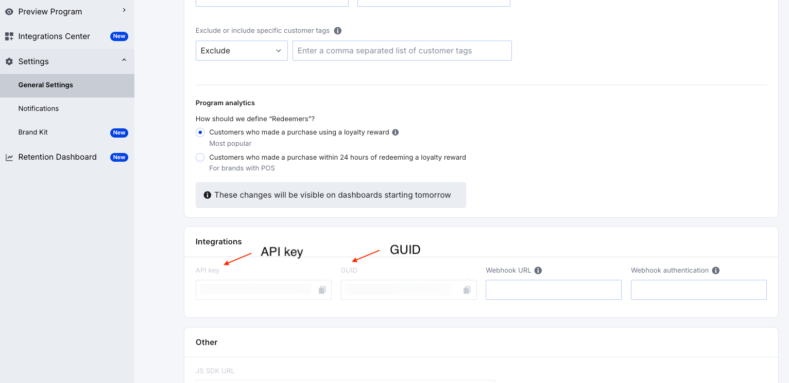
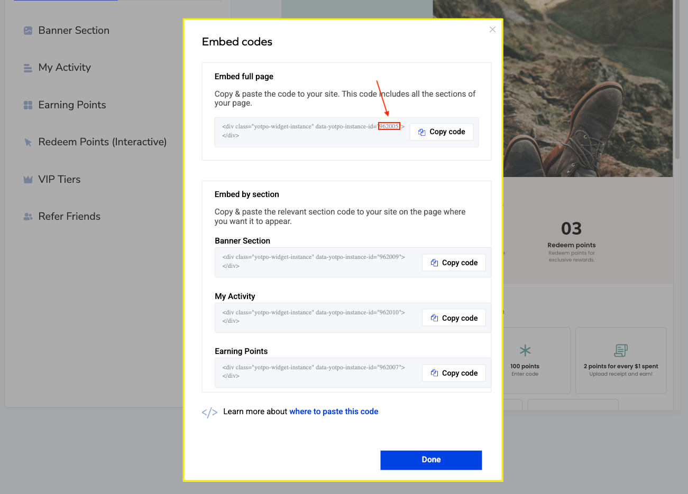

# Shopgate Connect - Yotpo Rewards

This extension integrates a Shopgate app with the [Yotpo Rewards](https://www.yotpo.com/platform/loyalty). Yotpo is a loyalty provider that rewards the user with points for discounts and free items.

The extension provides a custom route `/yotpo-rewards` that displays the Yotpo Rewards widget. Users need to be logged in to visit this route and will be prompted with a login form if they are not logged in.

## Requirements

PWA 7.35.0 or newer, the first version with a configurable tab bar. Until 7.35.0 is released, the extension declares `@shopgate/engage` `>=7.35.0-alpha.5`; with the release the range moves to `>=7.35.0` and the `@shopgate` dev dependencies to `^7.35.0`, with a fresh lockfile.

## Tab bar

The extension registers the navigation action `@shopgate-project/yotpo-rewards/rewards`. It never adds itself to the tab bar: merchants add "Rewards" ("Prämien" in a German admin) to the tab bar items in the Theme Config of the admin. The tab shows `tabBarIconLabel` as plain text, which defaults to "Rewards" in every language. When the merchant clears the field, the tab shows the name of the item in the admin instead ("Prämien" in German shops (de-DE), "Rewards" in all others). The tab shows the icon `@shopgate-project/yotpo-rewards/rewards`. Merchants replace the icon in the icon library of the admin; by default it is a tag with a heart. The tab opens `/yotpo-rewards` and is highlighted there. Without the tab, navigation can happen e.g. via a link inside an HTML widget: `<a href="/yotpo-rewards">Rewards</a>`.

> **Upgrading from 1.x:** version 1 added its tab after Cart by itself. After the update to version 2, the tab is missing until the merchant adds "Rewards" to the tab bar items in the admin and publishes. The admin offers the item once the shop's app runs version 2, so deploy first, then add it. The settings `hideTabBarIcon` and `tabBarIconSvg` are gone; a custom icon is set in the icon library instead. If the old value isn't a complete `<svg>` element, wrap it in `<svg xmlns="http://www.w3.org/2000/svg" viewBox="0 0 24 24">…</svg>` before you upload it.

## Configuration
Set the following values in your Shopgate Connect Admin:

### Required
- `guid` - (string) Needed to load the Yotpo Rewards Page inside the frontend. It can be retrieved from *Integrations => GUID* on the [General Settings](https://loyalty-app.yotpo.com/settings) page - [see screenshot](#api-key-and-guid).
- `apiKey` - (string) Needed to create a token in the backend to identify logged in users at Yotpo. It can be retrieved from *Integrations => API Key* on the [General Settings](https://loyalty-app.yotpo.com/settings) page - [see screenshot](#rewards-page-instance-id).
- `rewardsPageInstanceId` (string) - Needed to identify the correct Yotpo Rewards Page to be shown. Goto the [Rewards Page Builder](https://loyalty-app.yotpo.com/rewards-page-builder-widget), select the page you want to be used by the extension, click the **</>** icon and copy **only** the number from `data-yotpo-instance-id="1059421"` inside the "Embed full page" section.

### Optional
- `rewardsPageTitle` (string) Title for the Rewards Page (default: "Rewards")
- `tabBarIconLabel` (string) Text of the rewards tab (default: "Rewards" in every language). Clear the field to use the name of the tab bar item in the admin instead ("Prämien" in German shops (de-DE), "Rewards" in all others)

#### API Key and GUID



#### Rewards Page Instance Id


## Development

Install the dependencies of `frontend` from the lockfile and run the checks there:

```shell
npm ci
npm run lint
npm test
```
